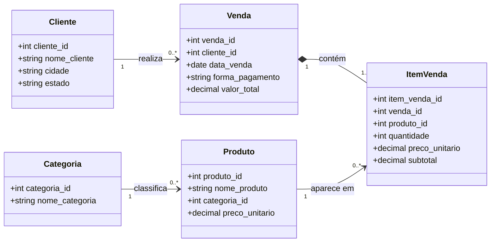
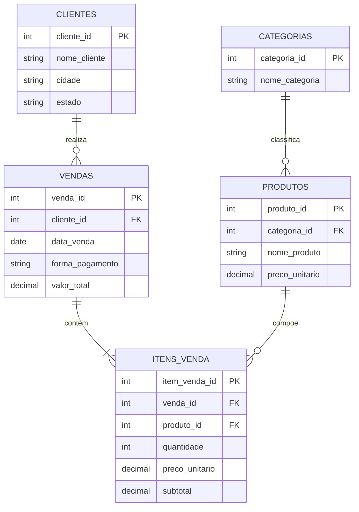

# Diagramas do projeto Dashboard de Vendas

Os diagramas abaixo representam o modelo encontrado nos scripts SQL do projeto. O banco possui cinco tabelas operacionais; o Power BI consome principalmente a view `vw_vendas_powerbi`, que combina os dados na granularidade de um item de venda.

## 1. Diagrama de classes

Este diagrama apresenta as classes de domínio, seus atributos e associações. `ItemVenda` representa cada produto dentro de um pedido e resolve a relação muitos-para-muitos entre `Venda` e `Produto`.

## 2. MER — Modelo Entidade-Relacionamento

As cardinalidades indicam: um cliente pode realizar várias vendas; cada venda pertence a um cliente. Cada venda possui um ou mais itens. Cada item aponta para um produto, e cada produto pertence a uma categoria.

## Como interpretar o modelo

- **Clientes → Vendas:** a chave `cliente_id` em `vendas` identifica quem realizou cada pedido.
- **Vendas → Itens da venda:** cada linha em `itens_venda` é um produto/linha dentro de um pedido; uma venda pode ter diversas linhas.
- **Produtos → Itens da venda:** `produto_id` identifica o produto vendido em cada linha.
- **Categorias → Produtos:** cada produto é associado a uma categoria por `categoria_id`.
- **Subtotal:** representa o valor da linha, normalmente `quantidade × preco_unitario`. Para somar faturamento a partir da view detalhada, use `SUM(subtotal)`.
- **Valor total da venda:** está registrado em `vendas.valor_total`; como o valor do pedido aparece repetido em cada item da view consolidada, não some essa coluna depois do JOIN. Para totalizar pedidos a partir da view, use uma agregação por venda ou some os subtotais dos itens.

## Camada analítica do PostgreSQL

`vw_vendas_powerbi` não é uma tabela transacional nova. É uma view que combina `vendas`, `clientes`, `itens_venda`, `produtos` e `categorias`. Sua granularidade é **uma linha por item de venda** e reúne campos de data, cliente, localização, forma de pagamento, produto, categoria, quantidade, preço unitário e subtotal.

As views `vw_resumo_cliente` e `vw_vendas_mensais` agregam essa fonte para análises de clientes e de períodos. Elas são objetos derivados e, portanto, não aparecem como entidades/tabelas no MER operacional.

## Conferência no PostgreSQL

No pgAdmin, abra as propriedades/colunas das tabelas `clientes`, `vendas`, `itens_venda`, `produtos` e `categorias` para confirmar tipos, chaves primárias e restrições de chave estrangeira configuradas no banco. Os scripts versionados deste repositório não declaram essas restrições com `CREATE TABLE`.

